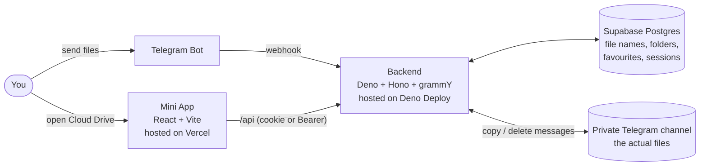
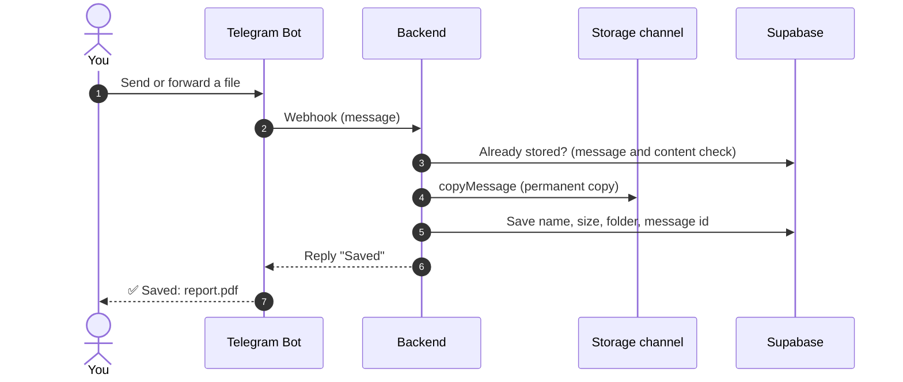
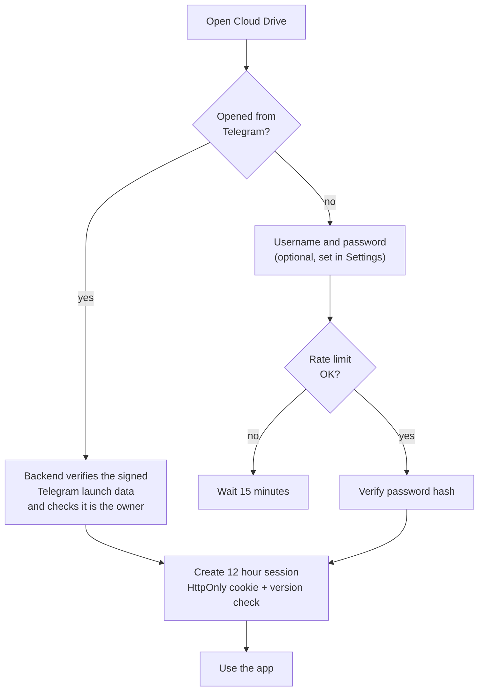

<div align="center">

# ☁️ Telegram Cloud Drive

**A private cloud drive that lives inside Telegram.**\
Send files to your own bot, keep them in your own channel, and organise everything from a Mini App.

[](https://github.com/kavidu-dilhara/telegram-cloud-drive/actions/workflows/ci.yml)
[](LICENSE)
[](https://github.com/kavidu-dilhara/telegram-cloud-drive/releases)
[](https://github.com/kavidu-dilhara/telegram-cloud-drive/stargazers)


[**📖 Deployment guide**](DEPLOYMENT.md) ·
[**🐞 Report a bug**](https://github.com/kavidu-dilhara/telegram-cloud-drive/issues/new?template=bug_report.yml)
·
[**💡 Request a feature**](https://github.com/kavidu-dilhara/telegram-cloud-drive/issues/new?template=feature_request.yml)
· [**📝 Changelog**](CHANGELOG.md)

<br />

<a href="https://vercel.com/new/clone?repository-url=https://github.com/kavidu-dilhara/telegram-cloud-drive&root-directory=frontend"></a>
&nbsp;
<a href="https://supabase.com/dashboard/new"></a>
&nbsp;
<a href="https://deno.com/deploy"></a>

</div>

> Replace `kavidu-dilhara` in the badges and buttons above with your GitHub username after you publish the
> repository.

---

## Table of contents

- [Why Cloud Drive](#why-cloud-drive)
- [Features](#features)
- [Architecture](#architecture)
- [Quick start](#quick-start)
- [Configuration](#configuration)
- [Local development](#local-development)
- [Project structure](#project-structure)
- [Security](#security)
- [Troubleshooting](#troubleshooting)
- [Contributing](#contributing)
- [License](#license)

## Why Cloud Drive

- **Your storage, your control.** Files live in a private Telegram channel you own. Names, folders and
  favourites live in your own Supabase project. There is no third-party file host.
- **Nothing to install for daily use.** Open the bot, send a file, tap **Open Cloud Drive**.
- **Single owner.** Only the Telegram account in `BOT_OWNER_ID` can use the bot and the app.
- **Honest status.** _Settings → Live status_ tests the database, the bot, the webhook and the storage channel
  for real and tells you what to fix.

## Features

| Area          | What you get                                                                                                    |
| ------------- | --------------------------------------------------------------------------------------------------------------- |
| Saving files  | Send or forward any file, photo, video, audio or voice message. Albums are handled and duplicates are detected. |
| Organising    | Nested folders, rename, move, copy, bulk select, favourites, list or grid view.                                 |
| Finding       | Search by name across all folders, filter by type or extension, sort by date, name or size.                     |
| Safety net    | Trash with Undo, restore, automatic purge after 30 days, manual **Empty Trash**.                                |
| Sharing       | One revocable link per file. The recipient receives the file from your bot.                                     |
| Preview       | Images under 2 MB.                                                                                              |
| Bot commands  | `/app` `/files` `/storage` `/newfolder` `/trash` `/favorite` `/favorites` `/shared` `/settings` `/help`         |
| Security      | Telegram sign-in, optional browser password, revocable sessions, rate-limited login, encrypted share tokens.    |
| Accessibility | Keyboard friendly, screen-reader labels, WCAG AA contrast, light / dark / Telegram theme, large touch targets.  |

Browser upload and download are intentionally **not** part of this project: files go in through the bot and
are delivered back through the bot.

## Architecture



### What happens when you send a file



### How sign-in works



## Quick start

For a slower walkthrough with a checkpoint after every step, read **[DEPLOYMENT.md](DEPLOYMENT.md)**.

You need a Telegram account and free accounts on [Supabase](https://supabase.com) (database),
[Deno Deploy](https://deno.com/deploy) (backend) and [Vercel](https://vercel.com) (frontend).

1. **Create the bot.** In Telegram open `@BotFather`, send `/newbot`, and keep the token.
2. **Create the storage channel.** Make a _private_ channel and add your bot as an **administrator** with
   permission to post messages. Note the channel id (it looks like `-1001234567890`) and your own numeric id
   from `@userinfobot`.
3. **Create the database.** In Supabase open _SQL Editor_, paste `supabase/schema.sql` and run it.
4. **Configure.** Copy `.env.example` to `.env` and fill in every value (see [Configuration](#configuration)).
   Generate secrets with `openssl rand -hex 32` (a different one for each secret).
5. **Deploy the backend.** Create a Deno Deploy project from this repository with entry point `src/main.ts`
   and add the variables from `.env`.
6. **Deploy the frontend.** Replace `YOUR-BACKEND.deno.dev` in `frontend/vercel.json` with your backend host,
   import the repository into Vercel with the **root directory set to `frontend`**, then set `MINI_APP_URL`
   (backend) to the Vercel address and redeploy the backend.
7. **Register the webhook:**
   ```bash
   deno task webhook          # registers /telegram/webhook with message + callback_query updates
   deno task webhook --info   # shows what Telegram currently has
   ```
8. **Connect the Mini App.** In `@BotFather`: `/mybots` → your bot → _Bot Settings_ → _Menu Button_ and set
   the URL to your Vercel address. Open your bot, send `/start` and tap **Open Cloud Drive**.
9. **Check everything.** Open _Settings → Live status_. Every row should say **OK**.

## Configuration

| Variable                                          | Required                | Description                                                                       |
| ------------------------------------------------- | ----------------------- | --------------------------------------------------------------------------------- |
| `BOT_TOKEN`                                       | yes                     | Token from BotFather                                                              |
| `BOT_OWNER_ID`                                    | yes                     | Your numeric Telegram user id                                                     |
| `TELEGRAM_WEBHOOK_SECRET`                         | yes                     | 32+ characters: letters, digits, `_` or `-`                                       |
| `STORAGE_CHANNEL_ID`                              | yes                     | Private channel id (`-100…`); the bot must be an admin that can post              |
| `MINI_APP_URL`                                    | yes                     | HTTPS origin of the frontend, no trailing slash                                   |
| `APP_URL`                                         | for `deno task webhook` | Public HTTPS URL of the backend                                                   |
| `SUPABASE_URL`, `SUPABASE_SERVICE_ROLE_KEY`       | yes                     | From Supabase → Project settings → API. The service key is backend-only           |
| `SESSION_SECRET`                                  | yes                     | 32+ characters, different from the webhook secret. Changing it signs everyone out |
| `BOT_USERNAME`                                    | no                      | Detected automatically                                                            |
| `DEV_ORIGIN`                                      | no                      | Extra allowed origin for local development (`http://localhost:5173`)              |
| `TRASH_RETENTION_DAYS`, `ACTIVITY_RETENTION_DAYS` | no                      | Automatic purge age in days, default 30                                           |

## Local development

```bash
cp .env.example .env                        # fill it in; set DEV_ORIGIN=http://localhost:5173
deno task dev                               # backend on http://localhost:8000
cd frontend && npm install && npm run dev   # Mini App on http://localhost:5173 (proxies /api)
```

Outside Telegram the app shows a password sign-in. Open it once from Telegram, go to _Settings → Account and
security_ and enable browser sign-in.

Quality checks (also run by GitHub Actions on every push):

```bash
deno fmt --check && deno lint && deno task check && deno task test
cd frontend && npm run lint && npm run build
```

## Project structure

```text
.
├── src/                    Backend (Deno + Hono + grammY)
│   ├── routes/             HTTP API: auth, files, folders, shares, system
│   ├── bot.ts              Bot commands and inline buttons
│   ├── storage.ts          Saving incoming files to the channel
│   ├── security.ts         Sessions, passwords, Telegram verification, encryption
│   └── maintenance.ts      Automatic purge of Trash and activity
├── frontend/               Mini App (React + Vite)
│   └── src/                pages/, components/, api.ts, telegram.ts
├── supabase/
│   ├── schema.sql          Database setup (safe to run more than once)
│   └── upgrade_existing.sql  Update a database created by an older release
├── scripts/set_webhook.ts  Registers the Telegram webhook
├── .github/                CI workflow and issue forms
├── DEPLOYMENT.md           Step-by-step deployment guide
└── CHANGELOG.md
```

## Security

- Never commit `.env`. `.env.example` contains placeholders only. If a real secret was ever committed, rotate
  it (BotFather → `/revoke`, a new Supabase service key, new random secrets) and purge it from git history.
- The service-role key bypasses row-level security. Keep it on the backend only.
- Password sign-in is limited to 10 failures per account or address per 15 minutes. Telegram sign-in is never
  locked out.
- Share links are unguessable 256-bit tokens, stored encrypted. Changing `SESSION_SECRET` makes existing links
  impossible to display in the app (they still work for recipients); revoke and re-share them if needed.
- Trash and activity are cleaned automatically (daily Deno Deploy cron, plus a lazy hourly check).

## Troubleshooting

| Symptom                                                     | Fix                                                                                                          |
| ----------------------------------------------------------- | ------------------------------------------------------------------------------------------------------------ |
| Bot ignores files or buttons do nothing                     | Run `deno task webhook --info`. `allowed_updates` must include `callback_query`; re-run `deno task webhook`. |
| _Live status_ says the storage channel is a problem         | Make the bot an admin of the channel with _Post messages_, and check `STORAGE_CHANNEL_ID`.                   |
| "Forbidden origin" in the browser                           | `MINI_APP_URL` must equal the exact frontend origin (or set `DEV_ORIGIN` for local work).                    |
| Sign-in screen says the server is not responding (HTTP 5xx) | Open `APP_URL/health` and the Deno Deploy logs; a missing or invalid environment variable stops the backend. |
| Opened in a normal browser: sign-in screen                  | Expected. Sign in with your browser password, or open the app from Telegram.                                 |
| Share link shows "unavailable"                              | Revoke it in _Shared_ and share the file again.                                                              |

More in [DEPLOYMENT.md](DEPLOYMENT.md#if-something-goes-wrong).

## Contributing

Bug reports and ideas are welcome: use the
[bug report](https://github.com/kavidu-dilhara/telegram-cloud-drive/issues/new?template=bug_report.yml) or
[feature request](https://github.com/kavidu-dilhara/telegram-cloud-drive/issues/new?template=feature_request.yml)
form. Before opening a pull request run the quality checks listed under
[Local development](#local-development).

## License

Released under the [Apache License 2.0](LICENSE).
